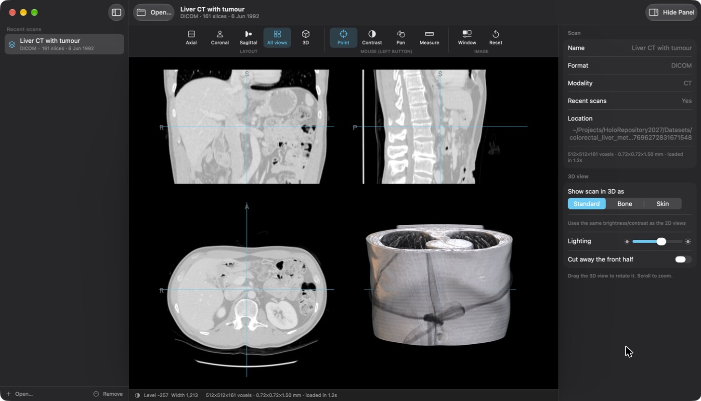
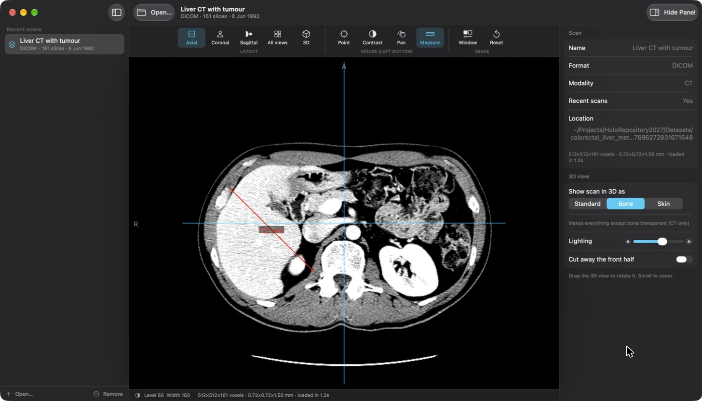
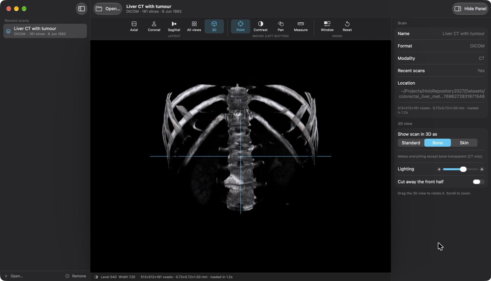
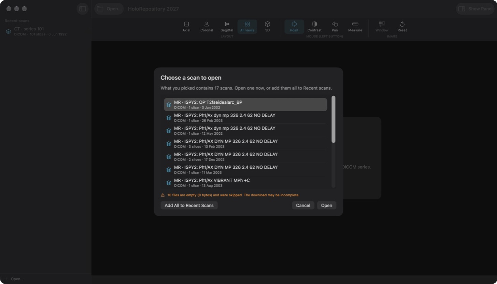

# HoloRepository for macOS

The macOS app for HoloRepository 2027. It opens CT and MR scans (DICOM or NIfTI) and shows them as 2D slices and a 3D view.

## Features

- Open DICOM files, NIfTI files (`.nii`, `.nii.gz`) or a whole folder.
- View the scan as axial, coronal and sagittal slices, or in 3D.
- Adjust brightness and contrast, with presets for CT.
- Pan, zoom and measure distances.
- Show the 3D view as Standard, Bone or Skin.
- Keep a list of recent scans for quick access. The app remembers where each scan is and never copies it.

## Run it

1. Open `HoloRepository2027.xcodeproj` in Xcode (version 26 or later, on macOS 15 or later).
2. Press **⌘R**.

## How to use it

- **Open a scan:** click **Open…** or drag files onto the window. If a folder has several scans, pick one from the list.
- **Change the layout:** use the buttons above the scan (Axial, Coronal, Sagittal, All views, 3D).
- **Choose what the mouse does:** Point, Contrast, Pan or Measure. Right-drag always changes contrast.
- **Use the right-hand panel:** it shows scan details and the 3D options.
- **Find a scan again quickly:** click **Add to Recent**. It stays in **Recent scans** after you quit. **Remove** only takes it off the list; the scan's files are not touched. If the files are moved or deleted, the scan shows "File not found".

## App icon

The icon artwork is `docs/branding/app-icon-source.png`. To change it, replace that file and run `python3 scripts/make_app_icon.py`, which needs Pillow (`pip install pillow`). The script makes every icon size Xcode needs.

## How it works

The window, buttons and Recent scans list are written in Swift (SwiftUI). The scan itself is drawn by [NiiVue](https://niivue.com), a medical image viewer running inside the app. The Windows app can reuse the same viewer, in the `WebViewer/` folder.

## Privacy

Scans are always read from where they already are, such as a hospital drive or a USB stick. The app never copies them and never sends them anywhere. Recent scans only stores a small bookmark to each scan's location.

## Credits

- [NiiVue](https://github.com/niivue/niivue) draws the scans (BSD 2-Clause licence). [dcm2niix](https://github.com/rordenlab/dcm2niix) converts DICOM for it (BSD licence). Their licences, and those of the libraries bundled inside them, are in `WebViewer/vendor/`.
- The screenshots show a scan from the Colorectal-Liver-Metastases collection, used under [CC BY 4.0](https://creativecommons.org/licenses/by/4.0/): Simpson, A. L., et al. (2023). *Preoperative CT and Survival Data for Patients Undergoing Resection of Colorectal Liver Metastases (Colorectal-Liver-Metastases)* (Version 2) [Data set]. The Cancer Imaging Archive. https://doi.org/10.7937/QXK2-QG03

## Coming next

- Sign in to the HoloRepository server.
- Send scans to the server for segmentation, then show the organs it finds in 2D and 3D.
- Unit tests.
