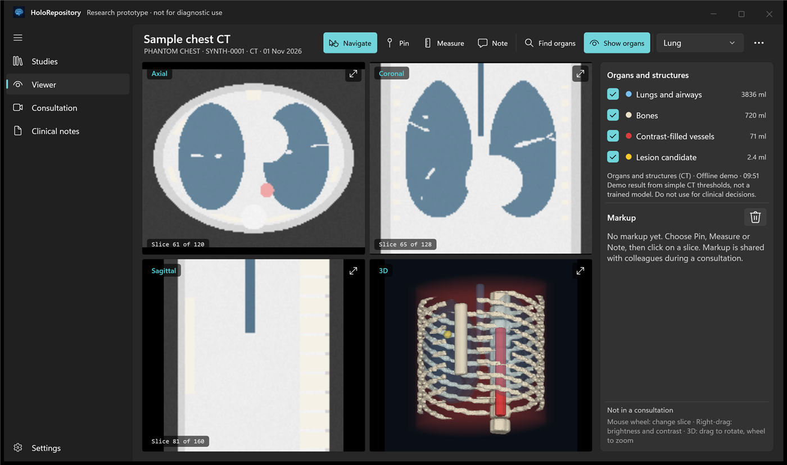
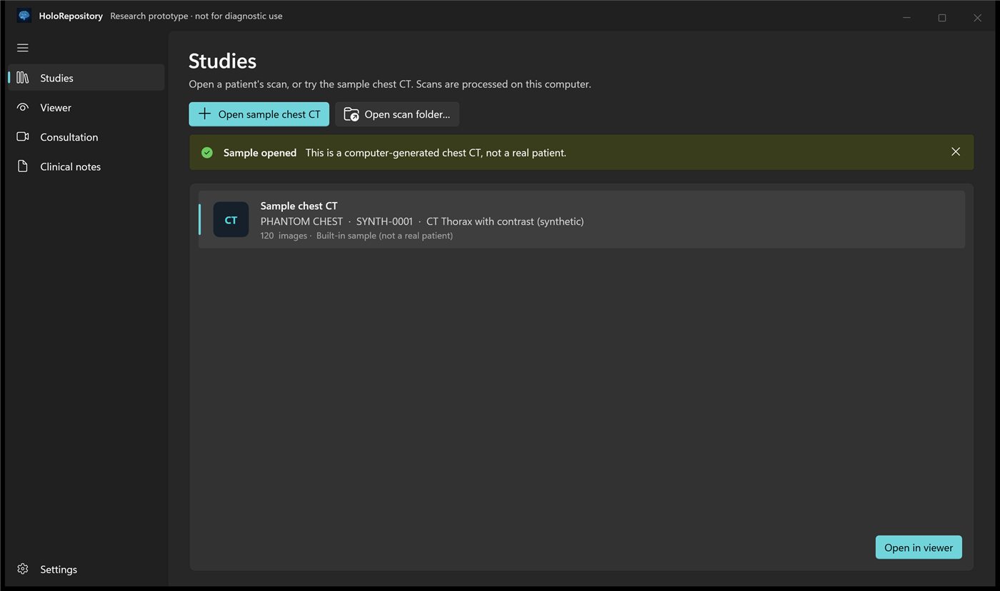
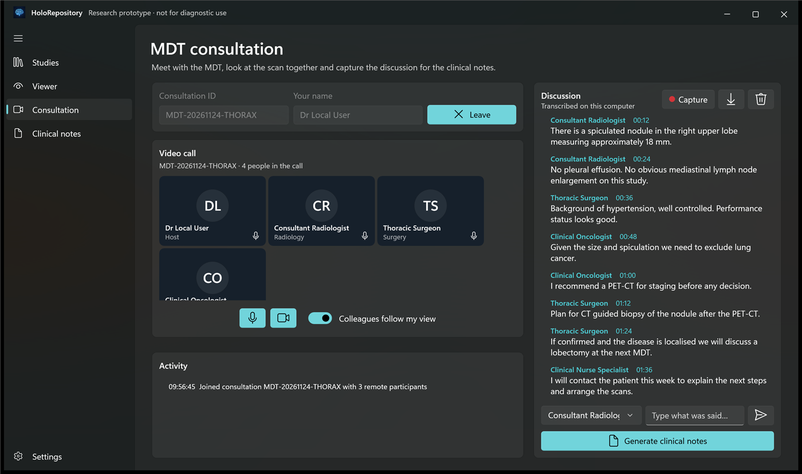
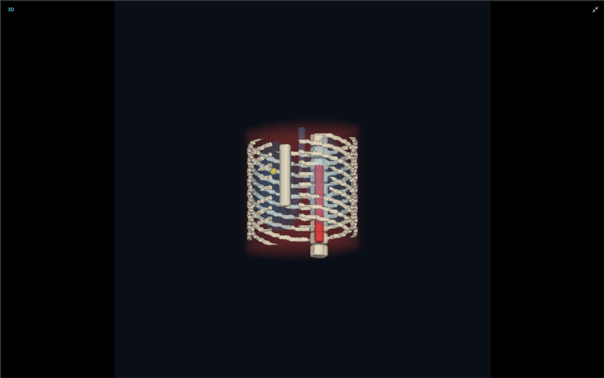

# HoloRepository for Windows

Prototype of the **HoloRepository 2027** Windows client: a native WinUI 3 application, packaged as MSIX, for examining volumetric imaging, finding organs with the HoloRepository server's segmentation models, running multidisciplinary team (MDT) consultations with shared spatial markup, and producing clinical and patient-facing notes.

> **Research prototype.** Not a medical device and not for diagnostic use. The repository contains no patient data; the app ships with a synthetic chest CT.



## What the prototype does

| Area | In the app | Brief |
|---|---|---|
| Native Windows client | WinUI 3 (Windows App SDK 1.7), Mica, dark "reading room" and light themes, pop-out viewer windows, full-screen viewports, MSIX packaging | FR-01 |
| Study ingestion | Opens a folder of DICOM files (grouped by series, sorted along the slice normal, rescale applied, patient position kept) or a synthetic chest CT. NIfTI images can be read and re-oriented for display | FR-03 |
| Viewing | Axial / coronal / sagittal MPR with tissue presets, crosshair sync and a 3D view (volume compositing or MIP). Any of the four views can be made full screen | FR-02, FR-04 |
| Finding organs | *Find organs* sends the scan to the HoloRepository server with the chosen model (`nv-segment-ct`, kidney, liver, head and neck), then shows the returned segmentation as colour on every slice and as 3D surfaces, with per-structure volumes and show/hide. An offline demo is used when not signed in | FR-10 |
| Spatial markup | Pins, measurements (mm) and notes stored in patient coordinates, shown on every plane and in 3D | FR-06 |
| Consultation | Webex integration point with simulated participants, viewport and markup sync, and consultation capture (ClinicAVT stand-in) | FR-05, FR-06 |
| Clinical notes | Structured MDT note plus a plain-language patient summary with a measured reading age (target ≤ 9), SNOMED CT grounding, NICE guideline links, and Markdown export | FR-07, FR-09 |
| Compute daemon | All imaging work goes through `IComputeDaemonClient`. The prototype runs it in-process, detects CUDA / Intel GPU / ARM64 hardware, and renders on the CPU | FR-03, FR-04, FR-08 |

The interface is written for clinicians. Engineering details (compute status, server address, latency figures, simulation controls, HU and window readouts) are hidden until **Settings › Advanced › Show technical details** is turned on.

Simulated or not yet implemented: GPU kernels (CUDA, OpenVINO/oneAPI), the Webex SDK, Granite 4.1 and ClinicAVT models, the MCP server, translations, and the macOS and mobile clients. See [docs/ARCHITECTURE.md](docs/ARCHITECTURE.md) for where each of these plugs in.

| Studies | Consultation | Clinical notes |
|---|---|---|
|  |  |  |

## HoloRepository server integration

The client talks to the HoloRepository FastAPI server in [`src/server`](../../server) (developed on the `server-init` branch) using its API contract v0.1.0:

1. **Settings › HoloRepository account**: sign in (`POST /token`) or create an account (`POST /signup`).
2. **Viewer › Find organs**: the series is zipped as DICOM (the original folder when there is one) and uploaded with the chosen model (`POST /new-job`).
3. The app polls `GET /job-status` until the job is `done`, finds the new record with `GET /records`, and downloads its `nifti_segmented` and `mz3` files (`GET /files/{id}`).
4. The label map is resampled onto the open series through patient coordinates, and the `.mz3` mesh is converted from RAS (NiiVue convention) into the series' space.

The server address is under **Settings › Advanced** (default `http://127.0.0.1:8000/`). Without a sign-in, *Find organs* uses an offline demo based on simple CT thresholds. It is clearly labelled as a demo and is not a trained model.

## Getting started

### Prerequisites

- Windows 10 1809 (build 17763) or later, x64 or ARM64
- [.NET 8 SDK](https://dotnet.microsoft.com/download/dotnet/8.0)
- Optional: Visual Studio 2022 with the *WinUI application development* workload, for XAML tooling and debugging

### Build and run

The Windows client lives in `src/clients/windows` of the HoloRepository repository; run these commands from that folder.

```powershell
dotnet build HoloRepository.Windows.sln
dotnet run --project src/HoloRepository.App -p:Platform=x64
```

Day-to-day builds run **unpackaged**, so no certificate or Developer Mode is needed. In Visual Studio, pick the `HoloRepository (Unpackaged)` launch profile.

> The app uses Windows App SDK 1.7. Version 1.6 could crash at startup when run from a very deep folder (for example inside `OneDrive\Documents\...`).

### Test

```powershell
dotnet test tests/HoloRepository.Core.Tests --collect:"XPlat Code Coverage"
```

The core library has 96 unit tests, with over 90% line coverage. They cover:

- DICOM and NIfTI reading, MPR geometry and rendering
- MZ3 meshes and surface extraction
- the server API client, run against an in-memory fake of the contract
- markup sync, terminology and readability

CI fails if coverage drops below 80%.

### Package as MSIX

```powershell
# Unsigned package
./scripts/Build-Msix.ps1

# Signed with a throwaway development certificate (writes files only; nothing is added to a certificate store)
./scripts/New-TestSigningCertificate.ps1 -OutDir artifacts/signing -Password dev
./scripts/Build-Msix.ps1 -CertificatePath artifacts/signing/HoloRepository-test.pfx -CertificatePassword dev
```

To install a test-signed package on a machine, trust the certificate once from an elevated PowerShell, then install:

```powershell
Import-Certificate -FilePath artifacts/signing/HoloRepository-test.cer -CertStoreLocation Cert:\LocalMachine\TrustedPeople
Add-AppxPackage artifacts/msix/HoloRepository.App_0.1.0.0_x64.msix
```

Pushes and pull requests that touch `src/clients/windows/` run the [Windows client workflow](../../../.github/workflows/windows-client.yml), which tests, enforces coverage and uploads a signed x64 MSIX together with its `.cer` as a build artifact.

## Trying it out

1. **Studies**: choose *Open sample chest CT*, or *Open scan folder…* for your own uncompressed CT/MR DICOM series.
2. **Viewer**: use the mouse wheel to change slice and right-drag for brightness and contrast. Pick **Pin**, **Measure** or **Note** and click a slice. Drag the 3D view to rotate it. Use the corner button on any view (or double-click the 3D view) for full screen, and press Esc to return. *New window* opens a second viewer that shares the same markup.
3. **Find organs**: choose a model, then *Start*. Structures appear in colour on the slices and in 3D, and the side panel lists each one with its volume and a show/hide checkbox.
4. **Consultation**: *Start consultation*, then press **Capture** to replay a sample MDT discussion. With technical details on, *Simulate colleague pin* and *Simulate colleague viewport* show remote markup and viewport sync.
5. **Clinical notes**: generates the MDT note and the patient summary from the transcript and the markup. Use *Export Markdown…* to save them.



## Repository layout

```
src/HoloRepository.Core/        UI-independent library (net8.0)
  Imaging/                      Volume, patient frame, DICOM/NIfTI/MZ3, phantom, MPR, ray caster, mesh renderer
  Daemon/                       IComputeDaemonClient, in-process implementation, hardware probe
  Segmentation/                 HoloRepository API client, server and offline-demo segmentation
  Markup/                       Annotations, annotation store, collaboration hub
  Notes/                        Transcript, terminology grounding, readability, note generation
src/HoloRepository.App/         WinUI 3 client (single-project MSIX)
  Pages/                        Studies, Viewer, Consultation, Notes, Settings
  Controls/                     SliceViewport, VolumeViewport
  Services/                     Composition root, settings, window helpers
tests/HoloRepository.Core.Tests xUnit tests
scripts/                        MSIX packaging and test certificate
docs/                           Architecture notes and screenshots
```

## Privacy

- Scans and transcripts are processed on this computer. A scan leaves the machine only when a signed-in user chooses *Find organs*; it is then sent to the configured HoloRepository server.
- The app has no telemetry. Settings live in `%LOCALAPPDATA%\HoloRepository\settings.json` (passwords are never stored), and unexpected errors are logged to `%LOCALAPPDATA%\HoloRepository\logs\app.log`.
- The SNOMED CT table is a small illustrative subset. Verify codes in the [NHS SNOMED CT browser](https://termbrowser.nhs.uk/) before relying on them.
