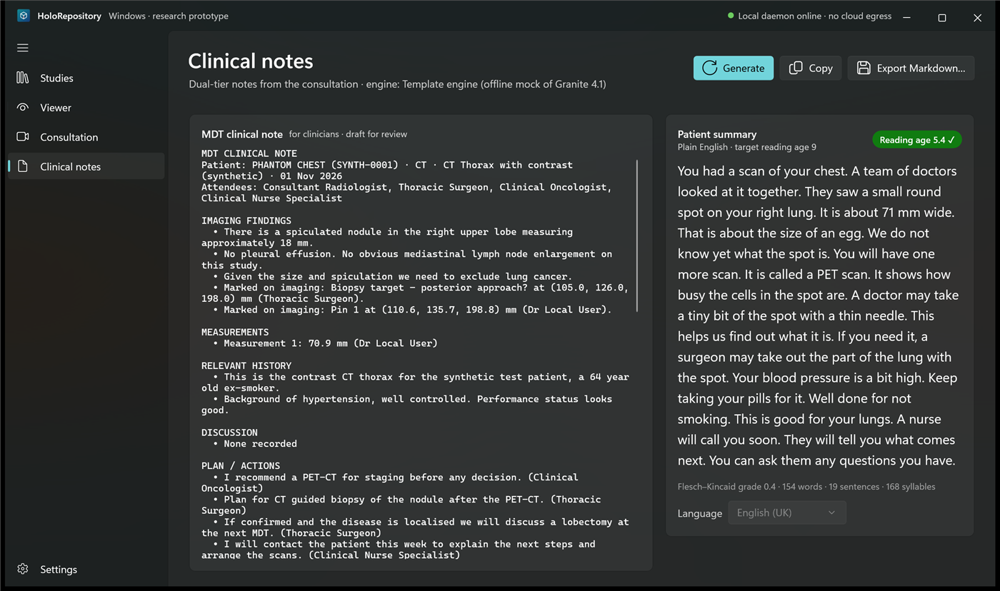

# HoloRepository for Windows

Prototype of the **HoloRepository 2027** Windows client: a native WinUI 3 application, packaged as MSIX, for examining volumetric imaging, running multidisciplinary team (MDT) consultations with shared spatial markup, and producing clinical and patient-facing notes.

> **Research prototype.** Not a medical device and not for diagnostic use. The repository contains no patient data; the app ships with a synthetic chest CT.


## What the prototype does

| Area | In the app | Brief |
|---|---|---|
| Native Windows client | WinUI 3 (Windows App SDK 1.7), Mica, dark "reading room" and light themes, pop-out viewer windows, MSIX packaging | FR-01 |
| Study ingestion | Opens a folder of DICOM files (grouped by series, sorted along the slice normal, rescale applied) or generates a synthetic chest CT. Can export a series back to DICOM | FR-03 |
| Viewing | Axial / coronal / sagittal MPR with window/level presets, crosshair sync, HU readout, and a 3D view (volume compositing or MIP) | FR-02, FR-04 |
| Spatial markup | Pins, calipers (mm) and callouts stored in patient coordinates, shown on every plane and in 3D | FR-06 |
| Consultation | Webex integration point with simulated participants, viewport and markup sync with latency against the 150 ms budget, and consultation capture (ClinicAVT stand-in) | FR-05, FR-06 |
| Clinical notes | Structured MDT note plus a plain-language patient summary with a measured reading age (target ≤ 9), SNOMED CT grounding, NICE guideline links, and Markdown export | FR-07, FR-09 |
| Compute daemon | All imaging work goes through `IComputeDaemonClient`. The prototype runs it in-process with no network access, detects CUDA / Intel GPU / ARM64 hardware, and renders on the CPU | FR-03, FR-04, FR-08 |

Simulated or not yet implemented: GPU kernels (CUDA, OpenVINO/oneAPI), the Webex SDK, Granite 4.1 and ClinicAVT models, the MCP server, segmentation, translations, and the macOS and mobile clients. See [docs/ARCHITECTURE.md](docs/ARCHITECTURE.md) for where each of these plugs in.

| Studies | Consultation | Clinical notes |
|---|---|---|
|  |  |  |

## Getting started

### Prerequisites

- Windows 10 1809 (build 17763) or later, x64 or ARM64
- [.NET 8 SDK](https://dotnet.microsoft.com/download/dotnet/8.0)
- Optional: Visual Studio 2022 with the *WinUI application development* workload, for XAML tooling and debugging

### Build and run

The Windows client lives in `src/clients/windows` of the HoloRepository repository; run these commands from that folder.

```powershell
dotnet build HoloRepository.Windows.sln
dotnet run --project src/HoloRepository.App -p:Platform=x64
```

Day-to-day builds run **unpackaged**, so no certificate or Developer Mode is needed. In Visual Studio, pick the `HoloRepository (Unpackaged)` launch profile.

### Test

```powershell
dotnet test tests/HoloRepository.Core.Tests --collect:"XPlat Code Coverage"
```

The core library has 66 unit tests covering DICOM round-trips, MPR geometry, rendering, markup sync, terminology and readability, with over 90% line coverage. CI fails if coverage drops below 80%.

### Package as MSIX

```powershell
# Unsigned package
./scripts/Build-Msix.ps1

# Signed with a throwaway development certificate (writes files only; nothing is added to a certificate store)
./scripts/New-TestSigningCertificate.ps1 -OutDir artifacts/signing -Password dev
./scripts/Build-Msix.ps1 -CertificatePath artifacts/signing/HoloRepository-test.pfx -CertificatePassword dev
```

To install a test-signed package on a machine, trust the certificate once from an elevated PowerShell, then install:

```powershell
Import-Certificate -FilePath artifacts/signing/HoloRepository-test.cer -CertStoreLocation Cert:\LocalMachine\TrustedPeople
Add-AppxPackage artifacts/msix/HoloRepository.App_0.1.0.0_x64.msix
```

Pushes and pull requests that touch `src/clients/windows/` run the [Windows client workflow](../../../.github/workflows/windows-client.yml), which tests, enforces coverage and uploads a signed x64 MSIX together with its `.cer` as a build artifact.

## Trying it out

1. **Studies**: choose *Load sample chest CT*, or *Open DICOM folder…* for your own uncompressed CT/MR series. *Export selected as DICOM…* writes the phantom out as a DICOM series, which is handy for testing the import path.
2. **Viewer**: use the mouse wheel to change slice and right-drag for window/level. Pick **Pin**, **Measure** or **Callout** and click a slice. Drag the 3D view to rotate it. *New window* opens a second viewer that shares the same markup.
3. **Consultation**: *Start consultation*, then try *Simulate colleague pin* and *Simulate colleague viewport* to see remote markup and viewport sync. Press **Capture** to replay a sample MDT discussion.
4. **Clinical notes**: generates the MDT note and the patient summary from the transcript and the markup. Use *Export Markdown…* to save them.

## Repository layout

```
src/HoloRepository.Core/        UI-independent library (net8.0)
  Imaging/                      Volume, DICOM loader/writer, phantom, window/level, MPR, ray caster
  Daemon/                       IComputeDaemonClient, in-process implementation, hardware probe
  Markup/                       Annotations, annotation store, collaboration hub
  Notes/                        Transcript, terminology grounding, readability, note generation
src/HoloRepository.App/         WinUI 3 client (single-project MSIX)
  Pages/                        Studies, Viewer, Consultation, Notes, Settings
  Controls/                     SliceViewport, VolumeViewport
  Services/                     Composition root, settings, window helpers
tests/HoloRepository.Core.Tests xUnit tests
scripts/                        MSIX packaging and test certificate
docs/                           Architecture notes and screenshots
```

## Privacy

- Pixel data and transcripts are processed on the local machine. The in-process daemon makes no network calls.
- The app has no telemetry. Settings live in `%LOCALAPPDATA%\HoloRepository\settings.json`, and unexpected errors are logged to `%LOCALAPPDATA%\HoloRepository\logs\app.log`.
- The SNOMED CT table is a small illustrative subset. Verify codes in the [NHS SNOMED CT browser](https://termbrowser.nhs.uk/) before relying on them.
