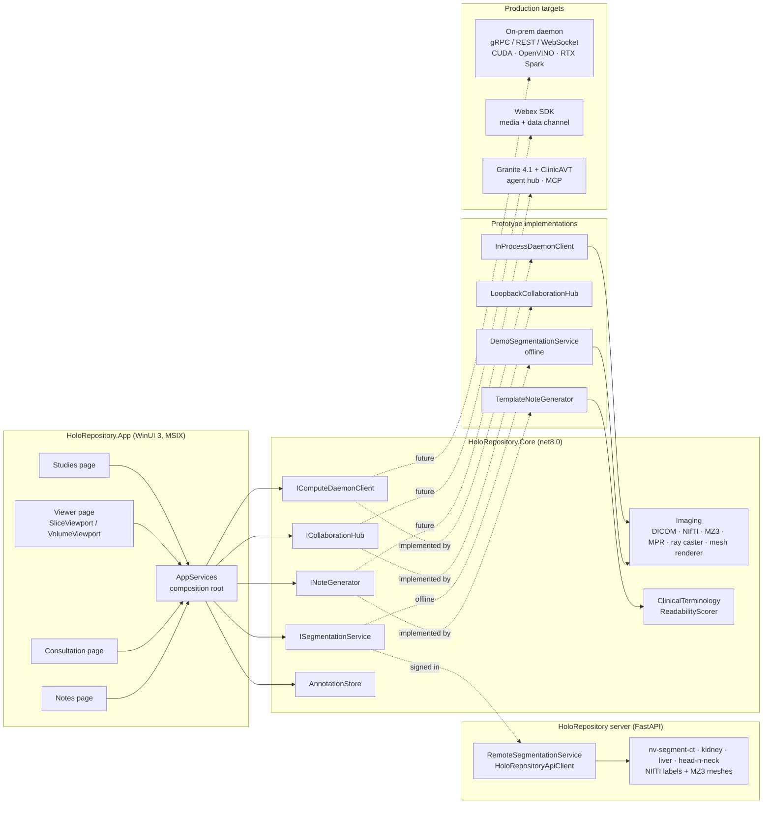

# Architecture

The brief describes three layers: native clients, a local compute daemon, and a clinical agent and integration hub. This repository contains the **Windows client**. Everything the client needs from the other two layers sits behind an interface in `HoloRepository.Core`, and an in-process implementation stands in for each one.

## Key decisions

**UI and compute are separated by an interface (FR-03, NFR "clean API boundaries").**
Pages never touch voxel data directly. They ask `IComputeDaemonClient` for slices (`GetSliceAsync`) and renders (`RenderVolumeAsync`) by series id. A gRPC/REST client for the standalone daemon can therefore replace `InProcessDaemonClient` in `AppServices` without UI changes. `GetGeometry` exposes only what the client needs for coordinate conversion.

**Markup lives in patient space.**
`Annotation` stores millimetre coordinates rather than screen or slice coordinates. `MprSlicer.SliceToPoint` and `PointToSlice` map those coordinates onto any plane, and `VolumeRenderer.Project` maps them into the 3D view. As a result, one pin appears correctly in every viewport, in every window, and on every remote client, whatever each client's camera is doing (FR-06).

**Consultation sync is message-based.**
`ICollaborationHub` publishes `Annotation` and `ViewportState` messages and raises events for remote ones. `LoopbackCollaborationHub` simulates three MDT peers with a configurable network delay and measures the round trip against the 150 ms budget. The production hub would carry the same messages over the Webex data channel or the daemon's WebSocket endpoint (FR-05).

**Note generation is pluggable and offline.**
`INoteGenerator` takes the transcript, the markup and the study metadata. It returns a structured MDT note, a patient summary, SNOMED CT concepts and NICE guideline references. `TemplateNoteGenerator` is deterministic and keeps the patient text at a reading age of 9 or below, checked by `ReadabilityScorer` (Flesch–Kincaid). A Granite 4.1 implementation can reuse the same grounding and readability checks (FR-07, FR-09).

**CPU reference renderer.**
`VolumeRenderer` is an orthographic ray caster that supports MIP and front-to-back compositing. It is deliberately simple, so it can serve as the reference that GPU backends are tested against. `HardwareProbe` reports which accelerators are present so the daemon can choose a backend (FR-04, FR-08).

**Segmentation comes from the HoloRepository server (FR-10).**
`ISegmentationService` has two implementations. `RemoteSegmentationService` follows the server's API contract (`HoloRepositoryApiClient`):

1. Zip the series as DICOM.
2. `POST /new-job` with the chosen `SegmentationModel`.
3. Poll `GET /job-status`.
4. Find the new record with `GET /records`.
5. Download the `nifti_segmented` and `mz3` files.

`DemoSegmentationService` is an offline stand-in that uses CT thresholds. Both return a `SegmentationResult` whose label map is aligned voxel-for-voxel with the open series. The Viewer tints slices with it, and `MeshRenderer` draws its surfaces over the volume render, blending up to four translucent layers per pixel so lungs do not hide what is inside them.

**Everything lines up through patient coordinates.**
Each `Volume` carries a `PatientFrame` (DICOM LPS origin and axis directions) taken from `ImagePositionPatient` and `ImageOrientationPatient`. NIfTI images (RAS affines) are resampled onto the series through that frame, and `.mz3` meshes from the server (RAS millimetres, as NiiVue expects) are converted with `PatientFrame.RasToLps` and `Volume.FromPatient`. NIfTI volumes opened for viewing are re-ordered into the same LPS axis order as DICOM, so anatomy is the right way up.

**Notes for the server team.**
- `JobStatus` does not say which record a job produced. The client compares `GET /records` before and after the job, which works for one user at a time. Returning a `record_id` with a finished job would make this exact.
- The server's mesh merges every label into one surface. When the label map has several structures, the client builds one coloured surface per label from the label map, and uses the server mesh directly only when there is a single structure.

## Threading

- Daemon calls run on the thread pool. Pages `await` them and update XAML on the UI thread.
- `AnnotationStore` and `LoopbackCollaborationHub` raise events on whichever thread made the change. UI handlers always marshal through `DispatcherQueue.TryEnqueue`.
- The Viewer drops stale slice responses using a version counter per plane. It also merges 3D render requests made while a render is already running into a single follow-up render.

## Extending the prototype

| To add | Implement | Register in |
|---|---|---|
| Remote compute daemon | `IComputeDaemonClient` (e.g. a gRPC client) | `AppServices.Daemon` |
| Webex consultation | `ICollaborationHub` over the Webex data channel | `AppServices.Hub` |
| Granite 4.1 / ClinicAVT notes | `INoteGenerator` | `AppServices.NoteGenerator` |
| Another segmentation backend | `ISegmentationService` | `AppServices.Segmentation` |
| GPU rendering | A backend inside the daemon, selected via `PreferredBackend` | daemon |
| New viewer tool | A `Tool` case in `ViewerPage.OnPointer` and an `OverlayKind` | `ViewerPage`, `SliceViewport` |
